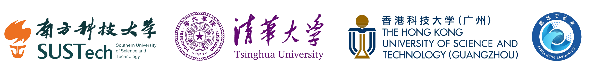
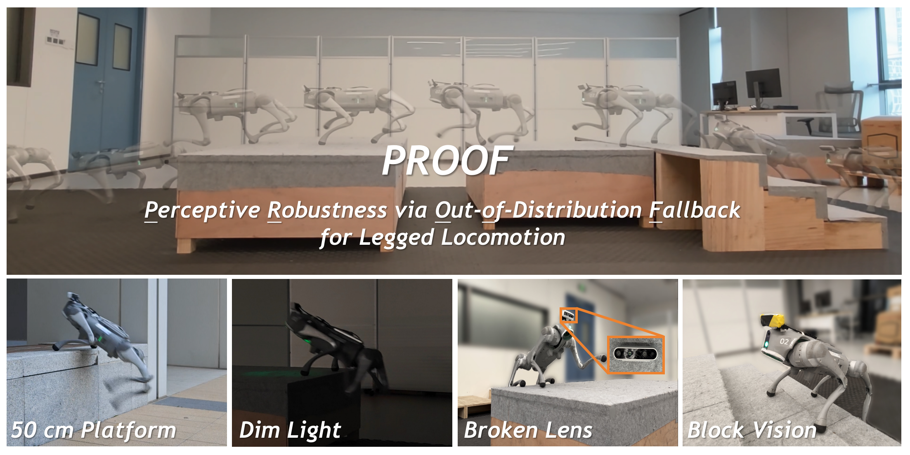

<h1 align="center">PROOF: <u>P</u>erceptive <u>R</u>obustness via <u>O</u>ut-<u>o</u>f-Distribution <u>F</u>allback for Legged Locomotion</h1>

<p align="center"><b>Conference on Robot Learning (CoRL) 2026</b></p>

<div align="center">

[[Website]](https://syw-robotics.github.io/proof-loco/)
[[arXiv]](https://arxiv.org/abs/2606.28476)
[[Online Demo]](https://syw-robotics.github.io/proof-loco/#interactive-demo)



<br>

[](https://github.com/isaac-sim/IsaacLab) [](https://docs.python.org/3/whatsnew/3.12.html) [](https://releases.ubuntu.com/22.04/) [](LICENSE)


<br>

<!--  -->

</div>


### Description

Considering Isaaclab has upgraded, this is a later re-implementation with:

- [LocoLab](https://github.com/syw-robotics/LocoLab): comprehensive manager based rl env for locomotion, built on IsaacLab 3.0
- [Z_RL](https://github.com/syw-robotics/z_rl): modular and flexible rl code, built on [rsl_rl](https://github.com/leggedrobotics/rsl_rl)

Additional features includes: muon optimizer, symmetry augmentation, more comprehensive terrains, student estimation warmup ...

### 📝 Todo List

- [x] Release training code
- [ ] Release deployment code


### ⚙️ Installation

Install [Isaac Lab 3.0](https://github.com/isaac-sim/IsaacLab), [LocoLab](https://github.com/syw-robotics/LocoLab), [Z_RL](https://github.com/syw-robotics/z_rl) and this repo:

We recommend using [uv](https://docs.astral.sh/uv/) to manage python envs.

For a first-time installation, run the commands below in order:

```bash
# Make sure uv is installed and create a workspace.
curl -LsSf https://astral.sh/uv/install.sh | sh
export PATH="$HOME/.local/bin:$PATH"

mkdir -p ~/<directory-you-like>
cd ~/<directory-you-like>


# Clone dependencies and PROOF.
git clone --branch main https://github.com/isaac-sim/IsaacLab.git
git clone https://github.com/syw-robotics/LocoLab.git
git clone https://github.com/syw-robotics/z_rl.git
git clone https://github.com/syw-robotics/proof-loco.git


# Create and activate Python 3.12, then install the stack.
uv venv --python 3.12 .venv
source .venv/bin/activate


# Install dependencies
bash LocoLab/install.sh "$PWD/IsaacLab" "$PWD/z_rl"


# Install this repo's packages
cd proof-loco
uv pip install -e source/proof_parkour -e z_rl_proof


# For later sessions
source ~/<directory-you-like>/.venv/bin/activate
cd ~/<directory-you-like>/proof-loco
```


#### Registered tasks

- `Proof-Heightmap-Parkour-PPO-Go2`: Proof teacher with mlp encoders
- `Proof-Vision-Parkour-Distill-Go2`: Proof student with cnn + gru for exteroceptive estimation
- `Vanilla-Heightmap-Parkour-PPO-Go2`: Vanilla teacher which fully observes exteroceptive heightmap without proprioceptive fallback
- `Vanilla-Vision-Parkour-Distill-Go2`: Vanilla student which fully observe exteroceptive depth image without proprioceptive fallback
<!-- - `Proof-Vision-RSSM-Parkour-Distill-Go2`: PROOF depth student using RSSM posterior-mean memory and a tanh terrain readout -->


### 🚀 Train & Play


**🚧 `newton_mjwarp` is not yet as stable as `physx` for multi terrain locomotion (maybe mujoco 4.0 is better ?)**
**🚧 Make sure using `physx` please, although it is much slower**

<br>

#### 1. PROOF Heightmap MLP Teacher Policy

- Pretrain on normal terrains as a warmup:
```bash
python scripts/z_rl/train.py --task Proof-Heightmap-Parkour-PPO-Go2 --physics ovphysx --num_envs 4096 --max_iterations 1500 --pretrain_terrain
```

- Resume on parkour terrains:
```bash
python scripts/z_rl/train.py --task Proof-Heightmap-Parkour-PPO-Go2 --physics ovphysx --num_envs 4096 --max_iterations 8500 --resume
```

You can change `max_iterations` as your like.

- Play teacher policy:

```bash
python scripts/z_rl/play.py --task Proof-Heightmap-Parkour-PPO-Go2 --physics ovphysx  --num_envs 40 --viser
```


- Tips:
    - You can replace `--viser` with `--viz newton_gl`, `--viz viser` for the Isaac Lab native viewers
    - Use `--checkpoint /absolute/path/to/model.pt` to point to a specific checkpoint
    - Append `--info` or `--verbose` to see more terminal logs during program init


#### 2. PROOF Vision GRU-CNN Student Policy

**If student training or playing failed, see [Troubleshooting 1](#1-cudacudnn-library-conflicts-or-slow-cnn-initialization).**

- Train student distillation:

```bash
python scripts/z_rl/train.py --task Proof-Vision-Parkour-Distill-Go2 --physics ovphysx --num_envs 4096 --max_iterations 10000 --teacher_checkpoint /absolute/path/to/teacher/model_99.pt
```


- Play student policy:

``` bash
python scripts/z_rl/play.py --task Proof-Vision-Parkour-Distill-Go2 --physics ovphysx  --num_envs 40 --viser
```


<!-- For the RSSM alternative, use `--task Proof-Vision-RSSM-Parkour-Distill-Go2` with a newly trained tanh-bounded teacher checkpoint. It reuses `z_rl.modules.RSSM` from `/home/syw/.gitrepos/z_rl_main`: `concat(prop_latent, cnn_latent)` feeds the posterior, then `tanh(Linear(concat(deter, stoch)))` produces the teacher-width terrain estimate. Default state widths are 128 deterministic and 32 stochastic; inference uses the posterior mean and no separate action input. -->


### 💛 Acknowledgement

- [IsaacLab](https://github.com/isaac-sim/IsaacLab) and [rsl_rl](https://github.com/leggedrobotics/rsl_rl)

- [InstinctLab](https://github.com/project-instinct/InstinctLab) for its camera obs pipeline and virtual obstacle implementation


### 🐛 Troubleshooting

#### 1. CUDA/cuDNN library conflicts or slow CNN initialization

If student training encounters CUDA/cuDNN library conflicts or excessive convolution initialization time with dynamic batch sizes, activate your virtual environment and run the following in the same terminal before launching training or playback.

```bash
export CURRENT_PY_ENV_SITE="$(python -c 'import sysconfig; print(sysconfig.get_path("purelib"))')"

# Prioritize the current virtual environment's cuDNN and CUDA 13 libraries.
export LD_LIBRARY_PATH="$CURRENT_PY_ENV_SITE/nvidia/cudnn/lib:$CURRENT_PY_ENV_SITE/nvidia/cu13/lib:$CURRENT_PY_ENV_SITE/torch/lib${LD_LIBRARY_PATH:+:$LD_LIBRARY_PATH}"

# Avoid high initialization overhead for dynamic-batch convolutions.
export TORCH_CUDNN_V8_API_DISABLED=1
```


### 📖 Citation

If you find this project useful, please consider citing:

```bibtex
@article{wang2026proof,
    title={PROOF: Perceptive Robustness via Out-of-Distribution Fallback for Legged Locomotion},
    author={Wang, Siyuan and Zhu, Dongjie and Lu, Jinxuan and Xu, Wenjun and Wang, Jiankun},
    booktitle={Conference on Robot Learning},
    year={2026}
}
```
